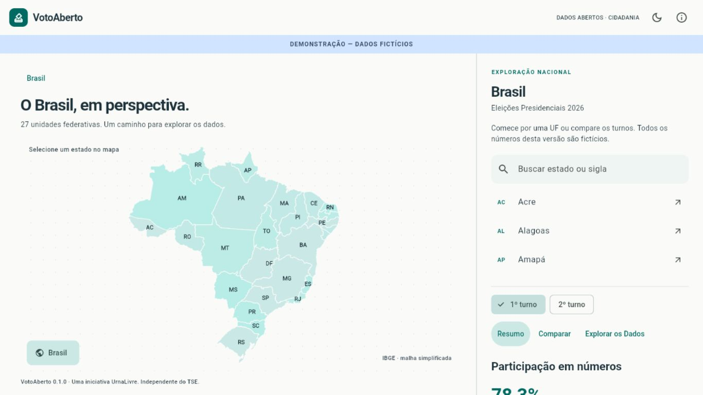

# VotoAberto

**Explore, compare e confira os resultados eleitorais brasileiros.**

[English summary](#english-summary) · [Visão do projeto](docs/VISION.md) · [Arquitetura proposta](docs/ARCHITECTURE.md) · [Arquitetura de dados](docs/DATA_ARCHITECTURE.md) · [Dados e proveniência](docs/DATA_POLICY.md) · [Roadmap](docs/ROADMAP.md) · [Como contribuir](CONTRIBUTING.md)

> **M4 — consulta municipal embarcada em prévia local.** O Flutter preserva a demonstração M1 e acrescenta um modo real explícito por JSONs derivados da release M3.1. Brasil, 27 UFs, municípios e exterior nos dois turnos funcionam sem API de resultados. Prontidão pública permanece `not_ready`; originais e derivados reais ficam fora do Git, sem publicação remota. [Operação](docs/EMBEDDED_DATA_MVP.md) · [Evidências M4](docs/M4_COMPLETION_REPORT.md).

O **VotoAberto** é um projeto de software livre do ecossistema [UrnaLivre](https://urnalivre.com.br/) para facilitar a exploração, a comparação e a conferência independente dos **dados eleitorais oficiais publicados pelo Tribunal Superior Eleitoral (TSE)**. A proposta é transformar conjuntos de dados complexos em consultas transparentes, acessíveis e reproduzíveis — sem substituir os documentos de origem.



## O que queremos construir

- **Mapa interativo do Brasil** com navegação de país → unidade federativa → município → zona → seção eleitoral, de acordo com a granularidade efetivamente presente nas fontes.
- **Resultados presidenciais de 2026**, comparando o primeiro e o segundo turnos, com cobertura nacional e do eleitorado no exterior quando disponível.
- **Consulta por seção eleitoral** com votos presidenciais, metadados mínimos e proveniência; os boletins de urna poderão ser usados na conferência e ter suas referências indicadas, **sem armazenar os BUs integrais na base pública**.
- **Painéis, filtros e gráficos** de votação, comparecimento, abstenção e variações entre turnos, respeitando as definições e limitações dos dados.
- **Análises exploratórias reproduzíveis**, com metodologia visível, possibilidade de exportação e explicações sobre hipóteses alternativas.
- **Experiência multiplataforma**: Windows, Web e Android, projetada para acessibilidade e uso por não especialistas.

O recorte inicial é **exclusivamente a eleição para presidente da República de 2026**. Outros anos e cargos podem ser considerados futuramente, mas não fazem parte do primeiro marco.

## Princípios

1. **Fontes primárias e rastreabilidade.** Distinguir sempre dados oficiais, processamento do projeto e interpretações.
2. **Nada de números inventados.** Dados demonstrativos devem ser claramente marcados como **FICTÍCIOS**, sem misturá-los aos resultados reais.
3. **Métodos verificáveis.** Documentar transformações, filtros, versões, algoritmos, hashes e divergências.
4. **Neutralidade político-partidária.** O software não endossa candidatos, partidos ou conclusões predeterminadas.
5. **Rigor nas inferências.** Uma anomalia estatística não prova fraude; a ausência de uma anomalia também não é prova geral de ausência de irregularidades.
6. **Transparência sobre limitações.** Uma seção eleitoral, seu boletim e um equipamento físico não devem ser tratados como equivalentes sem verificar os identificadores e eventos pertinentes.

## Produtos e estratégia de dados

O ecossistema adotará **um motor de importação configurável** e dois consumidores distintos:

- **VotoAberto (público):** Windows, Web e Android, com base derivada **compacta**, inicialmente apenas para **presidente da República em 2026**, nos dois turnos. O cidadão não precisa baixar os ZIPs completos do TSE para consultar os resultados. A base poderá apresentar votos por candidato e seção, totais definidos pelas fontes e proveniência, **sem armazenar boletins de urna integrais**.
- **VotoAberto Auditor (analistas):** ferramenta local para Windows e Linux, implementada inicialmente como CLI, que lê os arquivos oficiais completos, confere integridade, executa análises detalhadas e gera/reproduz as bases do VotoAberto.
- **Data Engine compartilhado:** importador com seleção de cargos, turnos, abrangências e perfis de exportação. Configuração padrão: **presidente, 1º e 2º turnos, perfil público compacto**. Outros cargos só serão habilitados após a validação de seus formatos específicos.

O motor mantém **SQLite versionado, manifesto e relatório** como base de processamento. M4 exporta dessa release, em modo somente leitura, **JSONs municipais compactos** para o cliente, sem transportar o SQLite completo. A futura API atenderá consultas detalhadas. Veja [ADR 0003](docs/adr/0003-public-data-and-auditor.md), [ADR 0004](docs/adr/0004-embedded-municipal-data.md), [arquitetura de dados](docs/DATA_ARCHITECTURE.md) e [roadmap](docs/ROADMAP.md).

## Dados oficiais e responsabilidade

Fonte primária prevista: [Portal de Dados Abertos do TSE](https://dadosabertos.tse.jus.br/), especialmente os conjuntos de **resultados por seção eleitoral** e **boletins de urna**. Os arquivos brutos não serão incorporados ao histórico do Git; a proposta é fornecer um pipeline documentado para que outros possam obter os originais e reproduzir os resultados.

O projeto é **independente**: não é mantido, patrocinado, homologado nem endossado pelo TSE. A disponibilização de dados oficiais não implica validação, pelo TSE, das análises feitas aqui. Consulte a [política de dados e atribuição](docs/DATA_POLICY.md) antes de republicar dados de terceiros.

## Tecnologia e estágio atual

A interface Flutter/Dart, o mock e o repositório de assets estão em `apps/votoaberto_flutter/`. O motor e o Auditor implementam inventário, hashes, parsers, reconciliação, SQLite e exportação JSON. [Investigação de SC](docs/TSE_2026_FORMAT_INVESTIGATION.md) e [operação](docs/DATA_ENGINE_OPERATIONS.md) preservam evidências anteriores. API ASP.NET Core e distribuição pública continuam futuras.

M3.1 acrescenta processamento por UF/turno, orçamento e limpeza segura de disco.
A carga local contém os 56 pares de 27 UFs + ZZ nos dois turnos e 5.731.614
resultados presidenciais reconciliados, sem diferenças entre as fontes fornecidas.
Isso não comprova completude de todas as seções nem autenticação das fontes.
SQLite de 935.424.000 bytes, pico contabilizado de 2,68 GiB e prontidão pública
`not_ready`. [Guia de operação nacional](docs/NATIONAL_IMPORT.md) e
[relatório investigativo](docs/TSE_2026_NATIONAL_INVESTIGATION.md).
Entrega, testes, recursos e limites no [relatório M3.1](docs/M3_1_COMPLETION_REPORT.md).

| Etapa | Estado |
| --- | --- |
| Documento de visão, princípios e plano inicial | Publicado |
| Explorador Flutter com dados sintéticos | Implementado no M1; verificações em [VALIDATION.md](docs/VALIDATION.md) |
| Importador configurável e SQLite presidencial compacto | Implementados no M2; primeira validação local de SC, sem publicação remota |
| Importação presidencial nacional, dois turnos e ZZ | Executada localmente no M3.1; política de prontidão pública ainda bloqueia publicação |
| Consulta Brasil → UF → município e ZZ | Implementada M4, prévia local com JSONs reais fora do Git |
| Consulta por zona e seção; referências aos boletins de origem | Futura API |
| Publicação Web / Windows / Android | Planejado |

Para detalhes e critérios de aceitação, consulte o [roadmap](docs/ROADMAP.md).

## Executar o aplicativo

Pré-requisitos: **Flutter 3.47.8 / Dart 3.13.7** (versão de referência do M1),
Git e navegador compatível. Windows requer Visual Studio com **Desktop development
with C++**, MSVC, CMake e Windows SDK. Android requer JDK 17, Android SDK e
licenças aceitas; veja também o diagnóstico `flutter doctor -v`.

```powershell
cd apps/votoaberto_flutter
flutter pub get
flutter run -d windows
# Ou navegador:
flutter run -d chrome
```

Na máquina de desenvolvimento desta entrega o SDK fica em `.local/flutter/`,
ignorado pelo Git, sem alterar o PATH global. Na raiz, para usar essa instalação:

```powershell
$env:PATH = "$PWD\.local\flutter\bin;$env:PATH"
cd apps/votoaberto_flutter
flutter doctor -v
flutter run -d windows
```

### Modo real e builds

Na raiz, após instalar o Auditor e gerar os JSONs da release existente:

```powershell
votoaberto-auditor export-embedded --dataset data/processed/national-2026 --output data/processed/embedded-presidential-2026 --json .local/embedded-export.json
python apps/votoaberto_flutter/tool/embedded_build.py windows --mode real --source data/processed/embedded-presidential-2026 --flutter .local/flutter/bin/flutter.bat
python apps/votoaberto_flutter/tool/embedded_build.py run --mode real --flutter .local/flutter/bin/flutter.bat -- -d windows
```

O build real falha sem a mini-base validada. `--mode fixture` usa somente dados
fictícios do CI; `--mode demo` preserva o M1. O wrapper empacota apenas o modo
escolhido e restaura o pubspec. [Contrato, instalação, Web/APK e limites
offline](docs/EMBEDDED_DATA_MVP.md).

### Testes e demonstração M1

```powershell
flutter pub get
dart format --output=none --set-exit-if-changed lib test integration_test
flutter analyze
flutter test --coverage
flutter build windows --release
flutter build web --release --no-web-resources-cdn
flutter build apk --debug
# Com um dispositivo/emulador Android configurado:
flutter devices
flutter run -d <id-do-dispositivo>
```

APK debug serve para validação local; assinatura/distribuição de produção não
estão configuradas. O workflow [Flutter](.github/workflows/flutter.yml)
verifica formato, análise, testes e builds, sem publicar artefatos em produção.
Resultados executados: [M1 histórico](docs/VALIDATION.md) e [M4](docs/M4_COMPLETION_REPORT.md).

### O que experimentar

Selecione uma UF pelo mapa ou pesquise nome/sigla (sem necessidade de acentos).
O mapa enquadra a seleção, o painel apresenta o estado e o seletor de turno
mantém essa seleção. Use **Comparar** para contagens, percentuais dos candidatos
e variações; **Explorar os Dados** para o ranking de comparecimento fictício.
**Brasil** retorna ao país. Tema e fontes ficam no cabeçalho.

No mapa, Tab dá foco; setas percorrem UFs alfabeticamente; Enter seleciona;
Escape/Home retorna ao Brasil. Busca/lista são alternativas para o DF e UFs
pequenas. Gráficos possuem resumos semânticos. A preferência de redução de
movimento desativa a animação do mapa. Desktop tem painel lateral com rolagem;
mobile/tablet usam mapa e painel em sequência, com rolagem vertical.

URLs Web usam o hash padrão do Flutter, por exemplo
`/#/uf/SP?turno=2&visao=comparison`; voltar/avançar recupera o recorte da URL.
No modo embarcado, busque uma cidade após escolher a UF, por exemplo
`/#/uf/SP/municipio/71072?turno=2&visao=comparison`. Exterior tem entrada própria,
sem polígono; Brasil real inclui ZZ e a metodologia distingue o total doméstico.
Zonas, seções e boletins continuam futuros. A demonstração M1 conserva seus limites.

### Código, dados e decisões

```text
apps/votoaberto_flutter/
  lib/app/                    composição, tema, strings e roteamento
  lib/core/                   formatação e componentes compartilhados
  lib/features/elections/     domínio, contrato, mock e repositório de assets
  lib/features/explorer/      controller e experiência de exploração
  lib/features/map/           GeoJSON, projeção, hit-test, câmera e renderizador
  assets/geo/                 geometria IBGE e atribuição
  test/                       domínio, controller, mapa e widgets
backend/                      API planejada após validação dos dados
apps/votoaberto_auditor/       CLI Python local
pipelines/tse_importer/        motor compartilhado e SQLite
```

Estado com `ChangeNotifier`/`ListenableBuilder` e navegação com `go_router`.
`intl` e localizações Flutter fornecem pt-BR. O renderizador usa `CustomPainter`,
sem WebView, tiles, fontes externas ou chamadas de rede durante a exploração.
O modo real carrega primeiro manifesto/Brasil/UFs e mantém cache municipal limitado.
Web não garante offline após reiniciar o navegador; PWA fica para outra etapa.
O mock-v1 é determinístico e matematicamente consistente, mas não representa
população, votação ou comportamento real. Brasil soma as 27 UFs; exterior não
incluído. Não inferimos transferência de votos entre pessoas.

- [Arquitetura e substituição pela API](docs/ARCHITECTURE.md)
- [Decisão de cartografia](docs/adr/0001-vector-map.md)
- [Estado, navegação e mock](docs/adr/0002-state-data-navigation.md)
- [Origem, condições de uso e hash do GeoJSON](docs/CARTOGRAPHY.md)

Continuam pendentes no aplicativo: API, consulta por zona/seção e BU, exportação
pelo cidadão, identidade oficial, persistência de preferências,
segundo idioma, avaliação de acessibilidade com usuários e distribuição.

## Relação com o UrnaLivre

O **UrnaLivre** é o ecossistema do qual o VotoAberto faz parte. O VotoAberto **analisa dados já publicados**; é um produto diferente da ideia futura de pesquisa em um **sistema de votação aberto e criptograficamente verificável**, possivelmente com técnicas de criptografia homomórfica. Não confundir as finalidades nem atribuir ao VotoAberto garantias criptográficas que ele não fornece.

## Colaboração e licença

Contribuições, sugestões de acessibilidade, revisão de métodos estatísticos, modelagem geográfica, documentação e testes são bem-vindos. Veja [CONTRIBUTING.md](CONTRIBUTING.md).

**Código-fonte:** licença [MIT](LICENSE), salvo indicação expressa em contrário. **Dados do TSE, cartografia, marcas e demais materiais de terceiros:** sujeitos às suas respectivas licenças e condições; a licença MIT do código **não** se estende automaticamente a eles.

---

## English summary

**VotoAberto** is an independent, open-source project within the **UrnaLivre** ecosystem to explore, compare, and trace Brazil's officially published election results back to their sources. The initial scope is the **2026 presidential election**, both rounds, with a navigable Brazil map and future polling-station/ballot-report consultation.

The **M1 demonstration** remains explicitly fictional. M2 adds the shared engine and Auditor; M3.1 produced the local presidential SQLite database. M4 exports independently validated compact JSONs for national/state/municipal and overseas Flutter consultation. Real builds remain local previews: public readiness is still `not_ready`, and real datasets are excluded from Git. No results API or public deployment was introduced. Web offline across browser sessions is not guaranteed. Statistical outliers do not establish misconduct; VotoAberto is **not affiliated with or endorsed by the TSE**. See the [M4 report](docs/M4_COMPLETION_REPORT.md).

The source code is MIT-licensed; third-party datasets, maps and trademarks retain their own terms.


## M5 — Explorador geográfico Brasil e Mundo

Resumo/Comparar, marcadores para 5.571 identificadores municipais e mapa mundial offline.
A correspondência exterior confirma 117 de 145 localidades em 80 países/territórios;
28 permanecem sem país, com acesso aos resultados preservado e totais reconciliados.

- [Relatório de entrega e pendências M5](docs/M5_COMPLETION_REPORT.md)
- [Fontes, arquitetura, licenças e reprodução](docs/GEOGRAPHIC_EXPLORER.md)
- [Resumo verificável de cobertura, totais, builds e preservação](docs/M5_VALIDATION_SUMMARY.json)

Sem API, alteração de releases eleitorais anteriores ou reprocessamento de ZIPs de votação.
