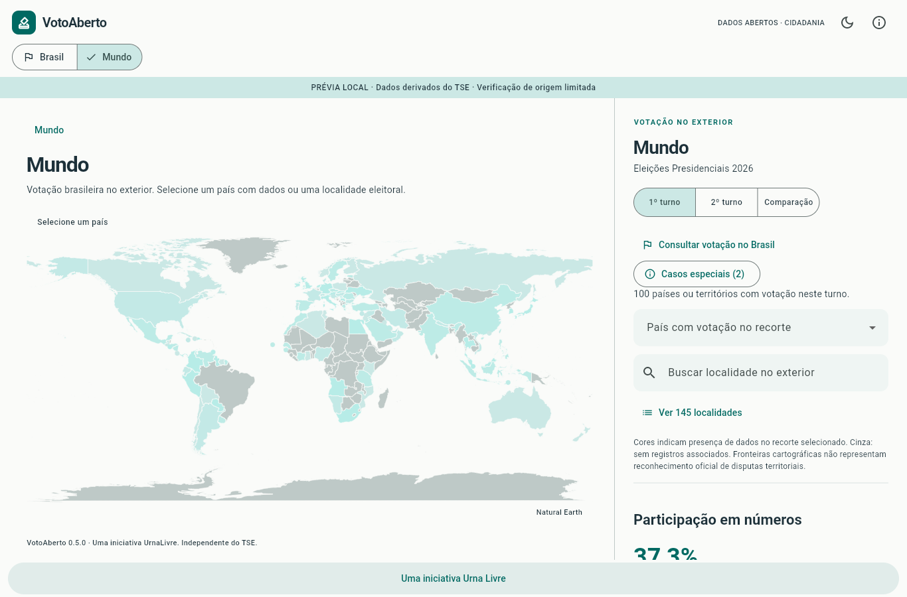
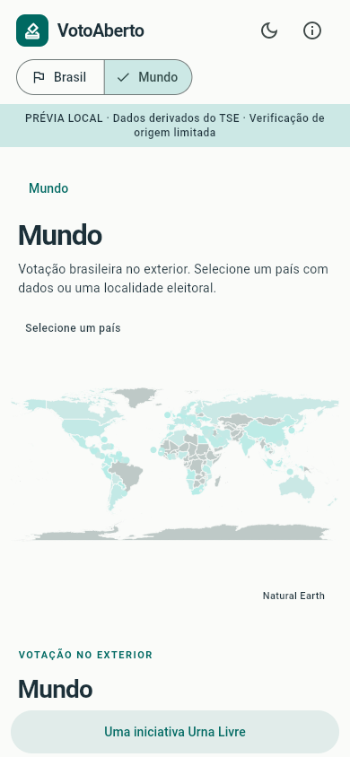

# Preparação da primeira publicação Web — relatório de entrega

> Atualização M6 (31/10/2026): [revisão de proveniência](WEB_DATA_PROVENANCE_REVIEW.md)
> obteve novamente 56 checksums oficiais BWEB, todos coincidentes com digests
> retidos. A fonte nacional continua sem referência independente encontrada;
> confiança humana e cache permanecem pendentes. Dados, manifestos e aprovação
> não foram alterados. A classificação continua **BLOCKED**. O texto abaixo
> preserva o relatório histórico da preparação Web.

Data: 31/10/2026. Branch `feat/web-production-cloudflare`, criada de
`origin/main` atualizado em `b8fb6f7` (merge do PR #8, incluindo M5.3).
Working tree inicialmente limpa. Nenhuma branch anterior foi sobrescrita ou excluída.

## A. Resumo executivo

A infraestrutura, o build JavaScript, o link institucional, os metadados, as
barreiras de integridade, o CI e o procedimento de operação foram implementados.
O aplicativo real compila e passou por validação automatizada de navegador.
O APK debug com a mesma base também compilou e teve seus JSONs conferidos.

**Classificação: BLOCKED para publicação pública.** O pacote eleitoral já existente
declara `not_ready`, com os blockers `source_hashes_reused_from_local_cache` e
`operator_trusted_hashes_incomplete`. A revisão dos termos de redistribuição não
está registrada. O CI de produção recusa esse pacote; não houve tentativa de
remover esses bloqueios, regenerar dados ou obter credenciais.

O trabalho de engenharia é revisável nesta branch. Resolver a origem e a
redistribuição é requisito anterior ao primeiro deploy, não uma exceção operacional.

## B. Implementação

- `apps/votoaberto_flutter/lib/core/institutional_link*.dart`: rodapé exclusivo da
  Web, SafeArea, texto acessível, href institucional e nova aba com proteção de opener.
  O delegate oficial Web resolve foco, teclado e navegação sem abrir o site na aba
  da aplicação. Apenas as dependências Web/platform interface foram acrescentadas;
  nenhum plugin Android/Windows/iOS do launcher foi introduzido.
- `web/index.html`, `manifest.json`: título **Voto Aberto — Urna Livre**, descrição
  fiel, pt-BR, tema, canonical e Open Graph básicos. Ícones existentes preservados.
  Não existe imagem social aprovada; não se inventou um logotipo ou card.
- `web/flutter_bootstrap.js`, `_headers`: renderizador/fontes locais, retirada
  limitada do worker legado, revalidação de cache e proteção de embedding.
- `wrangler.jsonc`: **votoaberto-web**, Static Assets em `./build/web`, data
  **2026-10-30**, nenhum backend/binding/rota DNS gerenciado por código.
- `tool/embedded_build.py`: reaproveitado, com `--production`, raiz `/`, saída Web
  limpa e restrita a `build/web`, restauração do pubspec e identidade do build.
- `tool/web_release.py`: auditoria do artefato e limites, gate de dados/termos,
  transporte GitHub Release com ZIP_STORED e extração validada sem paths externos.
- `web-data-approval.json`: deliberadamente sem aprovação ou seleção de dados.
- `package.json`, `package-lock.json`, `.node-version`, `playwright.config.cjs`,
  `test_browser/release.spec.cjs`: ferramentas fixadas e validação HTTP/browser.
- `.github/workflows/flutter.yml`: pipeline existente ampliado, preservando
  Windows/Android; `.github/workflows/deploy-web.yml`: rotina reutilizável de deploy,
  somente main após checks e ativação explícita. Data Engine conserva Ruff/pytest.
- `test/institutional_link_test.dart`, `tests/test_web_release.py`,
  `tests/test_embedded_build.py`: regressões de link, integridade, transporte e
  isolamento de modos. O smoke real antigo teve os seletores de turno atualizados
  para os controles já existentes na main, sem mudar cálculos ou expectativas de votos.

As URLs com hash já aprovadas foram preservadas. Não se adicionou fallback SPA:
`/` resolve index e recursos ausentes respondem 404 em vez de HTML 200.
Não houve redesign, mudança na contabilização, geografia ou navegação eleitoral.

Dois defeitos foram descobertos e corrigidos na validação real: dupla navegação
do link acessível e retenção de JSONs de outro modo entre builds Flutter sucessivos.
O segundo foi detectado pela auditoria antes de qualquer publicação e está coberto
por regressão no wrapper. A limpeza só alcança saída compilada; origens permanecem intactas.

## C. Preservação de dados

Fonte primária **atribuída pelo pacote**: TSE; processamento independente já
documentado no projeto. Mini-base existente em
`data/processed/embedded-presidential-2026/releases/e4e9c9cb5189ab5d4e124bfc`, instalada
em `apps/votoaberto_flutter/assets/data/real/`, fora do Git.

- ID: `e4e9c9cb5189ab5d4e124bfc`.
- SHA256 do manifesto: `c4dcddacb8092ff1dfffb35b07b739dbf360232e701e080087f52a4a09e20637`.
- Ano **declarado e consumido**: 2026, presidente, primeiro e segundo turnos.
- 32 JSONs, 4.475.495 bytes; 27 UFs e ZZ, 5.716 identificadores municipais/localidades.
- 5 JSONs/GeoJSONs geográficos conferidos byte a byte contra os assets originais.
- Snapshot de **74 arquivos** (release compacta, assets reais e geografia) antes e
  depois: todos os SHA256 iguais. Não se releram/reprocessaram ZIPs nem se alterou
  o SQLite nacional nesta missão.
- Hashes, tamanho, identidade, contagens e somas hierárquicas verificados pelo
  validador existente, tanto nos arquivos locais quanto no artefato Web.
- Os 37 JSONs eleitorais/geográficos no APK são idênticos à origem; zero arquivos
  de dados sintéticos no APK real.

Bruxelas/29432, Trípoli/30686, distinção de turnos e ausência de Trípoli no segundo
turno foram preservadas. Browser real abre as duas abas do diálogo e verifica a
mensagem de ausência. O smoke real confere totais nacionais e apresentação de
BR, SP, AC, RS, SC e ZZ nos dois turnos.

Essas verificações confirmam preservação e consistência do pacote, **não**
autenticidade das fontes, completude das seções ou legitimidade de redistribuição.
Não foram apresentados resultados de outro ano nem números fictícios como reais.

## D. Validações e evidências

Resumo legível por máquina: [WEB_RELEASE_VALIDATION.json](WEB_RELEASE_VALIDATION.json).
Logs completos locais ficam em `.local/web-release/`, ignorados pelo Git.

| Comando/verificação | Resultado |
| --- | --- |
| `flutter pub get --enforce-lockfile` | Aprovado com Flutter 3.47.8 / Dart 3.13.7 |
| `dart format --output=none --set-exit-if-changed lib test integration_test` | Sem alterações |
| `flutter analyze --no-pub` | Zero issues |
| `flutter test --no-pub --coverage --reporter expanded` | **155 aprovados, 7 ignorados, 0 falhas** |
| `flutter test test/real_embedded_smoke_test.dart --dart-define=RUN_REAL_EMBEDDED=true` | 7 aprovados, 0 falhas |
| `python -m pytest -q` com basetemp isolado | 181 aprovados, 2 ignorados; antes do último teste de transporte |
| pytest final de `test_web_release.py` + `test_embedded_build.py` | 37 aprovados, incluindo transporte e limpeza entre modos |
| Ruff format/check | Aprovado nos caminhos usados pelo CI |
| `embedded_build.py web --mode real` | Release JavaScript aprovado; compilação completa em 96,0 s e rebuild final em 13,1 s |
| `embedded_build.py web --mode fixture` + auditoria | Aprovado após limpeza da saída, sem JSONs reais residuais |
| `embedded_build.py apk --mode real` | APK debug aprovado, Gradle 133,4 s |
| `npm ci` com Node 22.23.4 | Aprovado |
| Playwright sobre build real + Wrangler local | **8 aprovados, 0 falhas** |
| Playwright sobre fixture + Wrangler local | **7 aprovados, 1 ignorado por exigir dados reais, 0 falhas** |
| `npm run deploy:check` | Dry-run Wrangler aprovado, sem upload/deploy remoto |
| actionlint 1.7.12, três workflows | Sem erros |
| Gate `web_release.py preflight` da base atual | Recusa esperada, exit 2, pelos blockers preservados |

O teste Web real usa o runtime local do Wrangler 4.156.0, Node 22.23.4 e Chrome
instalado. Verificou raiz 200; scripts, fonte, ícone e WASM com MIME correto;
cabeçalhos de segurança/cache; cada JSON recebido idêntico ao arquivo; 404 para
JS/JSON/PNG/WASM/rota inexistentes e para `_headers`.

O rebuild real final, após executar o modo fixture, produziu **os mesmos 82 arquivos
com os mesmos SHA256** do build real testado no navegador. Isso confirma a reprodução
local e a ausência de mistura de modos, sem repetir uma validação sobre bytes diferentes.

Também verificou carga sem erro fatal ou dependência externa na aba do app,
rotas diretas com recarga, voltar/avançar, SC e Mundo, link institucional com
teclado e nova aba sem opener, diálogo Bruxelas/Trípoli, tema escuro e retirada
de registro/caches Flutter sem apagar um cache não relacionado.

Viewports efetivos: **1366×900**, **390×844**, **844×390**, **800×600**.
Zoom visual 2× via CDP foi executado; não equivale a validar Ctrl+“+” nativo em
todos os navegadores. Os widgets do rodapé também foram testados com escala de
texto 2× e SafeArea de 24 px. Capturas desktop/mobile inspecionadas visualmente:

### Artefato real auditado

| Medida | Valor |
| --- | ---: |
| Arquivos no diretório final | **82** |
| Tamanho total, sem compressão | **49.065.783 bytes** (46,79 MiB) |
| Maior arquivo | `canvaskit/canvaskit.wasm`, **7.284.602 bytes** |
| `main.dart.js` | 3.269.288 bytes |
| Dados eleitorais, 32 JSONs | 4.475.495 bytes |
| Maior JSON eleitoral | `municipalities/MG.json`, 659.492 bytes |
| SP / RS / ZZ | 506.260 / 377.891 / 103.887 bytes |
| APK debug real | 155.990.073 bytes |

Dentro dos limites Free de 20.000 arquivos e 25 MiB individual. `_headers` é
contado conservadoramente no diretório, mas não servido como asset. Não há
ZIP/SQLite/dump bruto no Web. Os dois pares de ícones e a Roboto fallback
duplicados foram identificados e mantidos por compatibilidade do manifesto/SDK.
O dry-run imprime 99 entradas lidas: o Wrangler conta também os 17 diretórios
nessa mensagem; a medição de 82 arquivos regulares foi conferida separadamente.
Variantes/símbolos do renderizador são a maior oportunidade futura de redução,
condicionada a testes de navegadores; não se sacrificou dado eleitoral para caber.

No ambiente restrito, algumas primeiras execuções falharam por rede de dependências,
temporários e WebSocket do runner, antes de repetições válidas com o escopo liberado.
Falhas reais de testes foram corrigidas; nenhum `continue-on-error` foi adicionado.

## E. Segurança e operação

Secrets necessários: `CLOUDFLARE_API_TOKEN` e `CLOUDFLARE_ACCOUNT_ID`. Recomenda-se
token dedicado Editor/Edit limitado ao Worker existente `votoaberto-web`, sem DNS
ou acesso aos outros Workers. Environment `web-production` com revisão humana,
main protegida e variável `WEB_DEPLOY_ENABLED` só depois do go/no-go.

Cache por revalidação, nenhum immutable em nomes estáveis; nenhuma telemetria
no produto. CSP restrita somente à proteção de embedding, compatível com o build.
Rollback por versão Cloudflare, com automação pausada antes da operação.
Procedimento completo em [WEB_DEPLOYMENT.md](WEB_DEPLOYMENT.md).

Permanecem sem validação remota: secrets/conta, integração Cloudflare/GitHub,
deploy workers.dev, domínio, DNS, SSL e rollback real. Não houve inspeção
autenticada da conta; o operador deve confirmar que só GitHub Actions publica.
Safari/Firefox, leitor de tela humano, zoom nativo e uma aba durante um deploy
real ainda exigem verificação. A base atual deve continuar como prévia local
enquanto não houver evidência suficiente para aprovação de dados e termos.

## F. Git

Branch solicitada: `feat/web-production-cloudflare`. Commits separados para
interface/metadados, infraestrutura/testes e documentação/evidências; hashes
no relatório final e em `git log origin/main..HEAD --oneline`.
Commits de implementação: `7621f15` (link/metadados) e `0f673cf`
(Cloudflare, CI/CD, cache, empacotamento e testes). O terceiro registra este relatório.
O estado final da árvore e a lista exata de arquivos são verificáveis por
`git status --short` e `git diff origin/main...HEAD --stat`.

Sem push, PR, merge, tags, release pública, deploy ou alteração em outros
repositórios. Arquivos binários compilados e JSONs reais continuam fora do Git.
As duas capturas de tela de revisão são os únicos binários adicionados.

## G. Próximas ações humanas

1. Revisar esta branch e executar o CI no GitHub após o push deliberado.
2. Resolver blockers de origem e revisar termos do recurso; aprovar ID/hash dos
   dados em PR, sem editar artificialmente a avaliação para remover pendências.
3. Disponibilizar o bundle aprovado no tag de dados revisado deste repositório.
4. Criar somente o Worker `votoaberto-web`; gerar token dedicado e configurar
   os dois secrets, environment e proteções de main. Conferir ausência de Builds duplicado.
5. Após aprovação, ativar a variável e executar Flutter na main; validar workers.dev.
6. Associar só `votoaberto.urnalivre.com.br` no painel, validar SSL/DNS e executar
   checklist operacional, incluindo aba antiga/rollback.
7. Aprovar a tag proposta `v0.5.0` e as [notas](WEB_RELEASE_NOTES.md), sem publicação automática.
8. Depois de produção confirmada, habilitar o link no site institucional em tarefa
   separada. Nenhuma configuração desse outro repositório foi presumida ou alterada.

## H. Recomendação

**BLOCKED.** A branch pode ser revisada como preparação técnica, mas a publicação
dos dados locais não está aprovada. Os blockers são explícitos, preservados e
efetivamente impedem o caminho de produção; não se substituíram dados ausentes
ou avaliações incompletas por fixtures, autorização presumida ou documentação otimista.
